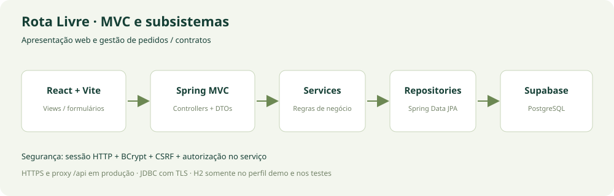

# 🏷️ Rota Livre — Sistema de Aluguel de Carros 👨‍💻

> [!NOTE]
> Gestão de pedidos e contratos de aluguel de automóveis, com acesso de clientes, empresas e bancos. Laboratório 02 de Desenvolvimento e Integração de Aplicações Web — PUC Minas.

<table>
  <tr>
    <td width="800px">
      <div align="justify">
        A <b>Rota Livre</b> reúne o processo de aluguel em uma aplicação web: o cliente mantém seu cadastro, escolhe um veículo e acompanha seu pedido; os agentes consultam os dados financeiros e registram seus pareceres. Após aprovação, o cliente confirma a contratação. O sistema registra o proprietário do automóvel e permite associar um <b>contrato de crédito concedido por banco agente</b>.
      </div>
    </td>
    <td></td>
  </tr>
</table>

---

## 🚧 Status do Projeto


Protótipo implementado, com testes de integração e build local. A conexão ao Supabase do grupo depende das credenciais; não há deploy público configurado.

---

## 📚 Índice

- [Links Úteis](#-links-úteis)
- [Sobre o Projeto](#-sobre-o-projeto)
- [Funcionalidades Principais](#-funcionalidades-principais)
- [Tecnologias Utilizadas](#-tecnologias-utilizadas)
- [Arquitetura](#-arquitetura)
- [Instalação e Execução](#-instalação-e-execução)
- [Deploy](#-deploy)
- [Estrutura de Pastas](#-estrutura-de-pastas)
- [Demonstração](#-demonstração)
- [Testes](#-testes)
- [Documentações utilizadas](#-documentações-utilizadas)
- [Autores](#-autores)
- [Contribuição](#-contribuição)
- [Agradecimentos](#-agradecimentos)
- [Licença](#-licença)

---

## 🔗 Links Úteis

- **Repositório:** [Ana-Sena/DIAW-LAB02-Aluguel-Carros](https://github.com/Ana-Sena/DIAW-LAB02-Aluguel-Carros).
- **Aplicação local:** http://127.0.0.1:5173 (após iniciar os dois serviços).
- **API:** [rotas, autenticação e exemplos](docs/api.md).
- **Modelagem:** [versões UML e justificativas](docs/modelagem/README.md).
- **Avaliação:** [histórias e requisitos](docs/requisitos.md) · [roteiro e validação](docs/validacao.md).
- **Formatação:** [template fornecido](template_README.md).

---

## 📝 Sobre o Projeto

O sistema atende ao enunciado do Laboratório 02, que propõe informatizar a gestão de aluguéis pela Internet. Organiza o cadastro dos contratantes, a análise financeira e a execução dos contratos, mantendo cada participante informado sobre seus pedidos.

O domínio está dividido em **gestão de pedidos e contratos**, no servidor, e **construção dinâmica das páginas web**, no React. O repositório preserva a modelagem inicial e sua revisão final.

### Regras de negócio

- Acesso após cadastro e login; senhas armazenadas com BCrypt.
- Cliente informa RG, CPF válido, nome, endereço, profissão e até três empregadores/rendimentos positivos.
- Cliente cria, consulta, modifica e cancela seus próprios pedidos; agentes consultam, modificam e avaliam pedidos.
- Alterações apagam o parecer/crédito anterior e devolvem o pedido à análise.
- Aprovação permite ao cliente confirmar o contrato. Pedidos contratados ou cancelados são imutáveis no protótipo.
- Propriedade prevista: cliente, empresa ou banco. Empresa/banco exige aprovação de agente da mesma categoria. Ao contratar, o proprietário é o cliente ou o agente avaliador, conforme o tipo escolhido.
- Apenas o banco autenticado concede crédito, limitado ao total do aluguel e a 1–120 parcelas.
- Total = diária × dias corridos, incluindo retirada e devolução. Máximo de 365 dias, com bloqueio de contratos sobrepostos para o mesmo carro.
- Conta com pedidos ou veículos vinculados não pode ser excluída, para preservar integridade e histórico.

---

## ✨ Funcionalidades Principais

| Cliente | Agente de empresa ou banco |
| --- | --- |
| Cadastro, login e logout | Cadastro, login e logout |
| CRUD do perfil e rendimentos | Consulta financeira de clientes |
| Consulta de frota e proprietários | Cadastro e consulta de frota |
| Criação, edição e cancelamento de pedidos | Consulta, edição e avaliação de pedidos |
| Busca e acompanhamento de status | Registro de parecer favorável ou desfavorável |
| Confirmação do contrato aprovado | Crédito opcional, exclusivo de banco |

Interface responsiva com painel de indicadores, busca, filtros, mensagens de validação e detalhes do contrato.

---

## 🛠 Tecnologias Utilizadas

### 💻 Front-end

- React 19, JavaScript, Vite 7, CSS próprio e ícones Lucide React.
- Fetch API, hooks e sessão por cookie de mesma origem.
- Prettier e dependências reproduzíveis em `package-lock.json`.

### 🖥️ Back-end

- Java JDK **25**, Spring Boot **4.0.6**, Apache Maven.
- Spring MVC, Spring Data JPA/Hibernate e Bean Validation.
- Spring Security: sessão HTTP, BCrypt, CSRF e autorização no serviço.
- Supabase PostgreSQL via JDBC/TLS. H2 somente em demo/testes.
- JUnit 5, MockMvc e Spring Security Test.

### ⚙️ Infraestrutura e desenvolvimento

- Git com Conventional Commits; GitHub Actions para testes e build.
- SQL versionado, exemplos de ambiente sem segredos e UML em PlantUML.

---

## 🏗 Arquitetura



O React compõe formulários, tabelas e modais. O cliente HTTP centraliza cookies, token CSRF e erros. O proxy `/api` mantém interface e API na mesma origem.

No servidor MVC, **Controllers** validam DTOs, **Services** aplicam permissões e regras transacionais, e **Repositories** persistem **Models** JPA. DTOs de saída impedem exposição de hashes de senha. `Rental` reúne o pedido e os dados opcionais de contrato/crédito.

Na contratação, a transação bloqueia a linha do veículo, verifica sobreposição e então registra o contrato. `@Version` detecta alterações concorrentes.

### Modelos UML

| Modelo | Inicial | Final |
| --- | --- | --- |
| Casos de uso | [Atores e funcionalidades](docs/modelagem/v1/casos-de-uso.puml) | Mantido, com regras detalhadas nos requisitos |
| Classes | [Conceitual v1](docs/modelagem/v1/classes.puml) | [Implementação v2](docs/modelagem/v2/classes.puml) |
| Pacotes | [Subsistemas v1](docs/modelagem/v1/pacotes.puml) | [Pacotes v2](docs/modelagem/v2/pacotes.puml) |
| Estados | Descrição nos requisitos | [Transições v2](docs/modelagem/v2/estados.puml) |

As [justificativas das revisões](docs/modelagem/README.md) explicam a implementação por papéis e o agrupamento de contrato/crédito no pedido.

---

## 🔧 Instalação e Execução

### Pré-requisitos

- JDK **25** e `JAVA_HOME` configurado.
- Maven **3.9+**.
- Node.js **22.12+** ou **24 LTS**, com npm.
- Projeto Supabase para o modo persistente. A demo local dispensa credenciais.

### 📦 Instalação de dependências

```bash
git clone https://github.com/Ana-Sena/DIAW-LAB02-Aluguel-Carros.git
cd DIAW-LAB02-Aluguel-Carros
npm --prefix frontend ci
```

Maven resolve as dependências ao testar/executar.

### ▶️ Demonstração local sem credenciais

**Terminal 1 — API com banco em memória:**

```bash
mvn -f backend/pom.xml spring-boot:run -Dspring-boot.run.profiles=demo
```

No PowerShell, use `"-Dspring-boot.run.profiles=demo"` se houver interpretação do argumento.

**Terminal 2 — React:**

```bash
npm --prefix frontend run dev
```

Abra http://127.0.0.1:5173. A API deve usar a porta 8080. Evite alternar entre `localhost` e `127.0.0.1` na mesma sessão.

| Perfil fictício | Usuário | Senha |
| --- | --- | --- |
| Cliente | `cliente` | `Demo@12345` |
| Empresa | `empresa` | `Demo@12345` |
| Banco | `banco` | `Demo@12345` |

Contas e três carros são criados **apenas no perfil demo**. Os dados são perdidos ao encerrar a API. No Supabase, cadastre usuários e frota pela interface.

### 🔑 Variáveis de ambiente — Supabase

1. Crie o projeto e obtenha a conexão PostgreSQL em **Connect**. Escolha conexão direta ou **Session pooler** conforme sua rede e preserve o usuário exibido no painel.
2. Execute [schema.sql](backend/src/main/resources/db/schema.sql) uma vez no **SQL Editor**.
3. Configure as variáveis e inicie a API sem o perfil demo.

| Variável | Finalidade | Exemplo |
| --- | --- | --- |
| `DATABASE_URL` | JDBC com TLS | `jdbc:postgresql://db.SEUPROJETO.supabase.co:5432/postgres?sslmode=require` |
| `DATABASE_USERNAME` | Usuário da conexão | `postgres` ou usuário do pooler |
| `DATABASE_PASSWORD` | Senha privada do banco | Definida no projeto Supabase |
| `COOKIE_SECURE` | Cookie exclusivo de HTTPS | `false` local; `true` em produção |
| `PORT` | Porta da API | `8080` |

Exemplo **PowerShell**:

```powershell
$env:DATABASE_URL="jdbc:postgresql://db.SEUPROJETO.supabase.co:5432/postgres?sslmode=require"
$env:DATABASE_USERNAME="postgres"
$env:DATABASE_PASSWORD="sua-senha-do-banco"
mvn -f backend/pom.xml spring-boot:run
```

[backend/.env.example](backend/.env.example) é uma referência: **Spring Boot não carrega `.env` automaticamente**. Não versione senhas. A interface usa `/api` e não recebe senha do banco ou chave de serviço do Supabase. As tabelas têm RLS sem políticas públicas; o acesso ocorre pelo servidor via JDBC.

### Solução de problemas

- **Java incompatível:** confira `java -version` e `mvn -version`; ambos devem usar JDK 25.
- **API indisponível:** confira porta 8080 e terminal do Maven.
- **Falha no Supabase:** confirme host, usuário do pooler, senha, TLS e rede. Não use URL REST no lugar de JDBC.
- **Erro de schema:** execute o SQL no projeto correto; o perfil padrão usa `ddl-auto=validate`.
- **Sessão/CSRF:** entre novamente ou atualize a página. Sessão expira após 30 minutos de inatividade.

---

## 🚀 Deploy

Não há publicação em produção configurada. Prepare os artefatos:

```bash
mvn -f backend/pom.xml clean package
npm --prefix frontend run build
```

1. Execute `java -jar backend/target/rotalivre-1.0.0.jar` em servidor Java 25 com as variáveis do Supabase.
2. Sirva `frontend/dist` com HTTPS e proxy reverso `/api` para o back-end **no mesmo domínio**. O proxy Vite não acompanha o build estático.
3. Use `COOKIE_SECURE=true` e não habilite o perfil demo.

A sessão reside na memória da API e exige novo login após reinício. Múltiplas instâncias precisam de sessão compartilhada ou afinidade. Cadastro aberto de agentes é decisão acadêmica; uso real exige validação administrativa.

---

## 📂 Estrutura de Pastas

```text
.
├── .github/workflows/ci.yml       # Testes e build
├── backend/
│   ├── pom.xml                   # Spring Boot 4 / Java 25
│   ├── .env.example
│   └── src/
│       ├── main/java/br/pucminas/rotalivre/
│       │   ├── config/           # Segurança e dados demo
│       │   ├── controller/       # MVC e tratamento de erros
│       │   ├── dto/              # Entradas e saídas
│       │   ├── model/            # Entidades JPA
│       │   ├── repository/       # Persistência
│       │   └── service/          # Regras e autorização
│       ├── main/resources/
│       │   ├── db/schema.sql     # Banco Supabase
│       │   └── application*.properties
│       └── test/                 # Integração
├── frontend/
│   ├── public/logo.svg
│   ├── src/                      # Componentes, HTTP e estilos
│   ├── package-lock.json
│   └── vite.config.js
├── docs/
│   ├── modelagem/v1/             # UML inicial
│   ├── modelagem/v2/             # UML revisado
│   ├── requisitos.md
│   ├── validacao.md
│   └── api.md
├── scripts/smoke.mjs              # Teste HTTP com sessões reais
├── CONTRIBUTING.md
├── template_README.md
└── README.md
```

---

## 🎥 Demonstração

### 🌐 Aplicação Web

| Tela | Demonstração |
| --- | --- |
| Login/cadastro | Acesso obrigatório e escolha do papel |
| Visão geral | Indicadores e pedidos recentes |
| Frota | Marca, modelo, matrícula, placa, ano, proprietário e diária |
| Meu perfil | Identificação e até três rendimentos |
| Pedidos | Criação, edição, filtros, cancelamento e status |
| Avaliação | Dados financeiros, parecer e crédito bancário opcional |
| Contrato | Número, data, banco concedente e propriedade |

Veja o [roteiro completo](docs/validacao.md#roteiro-de-apresentação-manual). Os carros são ilustrações SVG esquemáticas próprias; não reproduzem os modelos reais. Não há capturas de tela não verificadas; a limitação de revisão visual está documentada.

### 💻 Exemplo no terminal

Com a API demo e o Vite em execução:

```bash
node scripts/smoke.mjs
```

Saída esperada:

```text
Smoke HTTP aprovado: proxy, sessão, CSRF, pedido, alteração, cancelamento, análise, crédito, contrato e logout.
```

---

## 🧪 Testes

### Integração do back-end

```bash
mvn -f backend/pom.xml test
```

**13 cenários** JUnit/MockMvc com segurança real e H2, cobrindo autenticação, permissões, validações, cadastro, perfil, pedidos, crédito e contrato. Não exige credenciais externas.

### Front-end e fluxo HTTP

```bash
npm --prefix frontend run build
npm --prefix frontend run format:check
node scripts/smoke.mjs
```

O smoke exige os dois serviços e deve usar apenas o perfil demo. Reinicie a API antes de repetir. Não há suíte automatizada de navegador. Evidências e limites em [Validação](docs/validacao.md).

---

## 🔗 Documentações utilizadas

- [Spring Boot](https://docs.spring.io/spring-boot/4.0/) e [Spring Security](https://docs.spring.io/spring-security/reference/).
- [React](https://react.dev/reference/react) e [Vite](https://vite.dev/guide/).
- [Supabase — conexão PostgreSQL](https://supabase.com/docs/guides/database/connecting-to-postgres).
- [PlantUML — classes](https://plantuml.com/class-diagram).
- [Conventional Commits](https://www.conventionalcommits.org/pt-br/v1.0.0/).
- [Modelagem interna](docs/modelagem/README.md) e [API](docs/api.md).

---

## 👥 Autores

| Nome | GitHub |
| --- | --- |
| Ana Sena | [@Ana-Sena](https://github.com/Ana-Sena) |

Outros integrantes podem ser adicionados pelo grupo com seus dados confirmados.

---

## 🤝 Contribuição

Veja [CONTRIBUTING.md](CONTRIBUTING.md). Use branches, alterações incrementais, verificações e Conventional Commits:

```text
feat: adiciona avaliação financeira de pedidos
fix: impede contratação de veículo em período ocupado
test: cobre isolamento de pedidos entre clientes
docs: atualiza modelos UML e instruções de execução
```

---

## 🙏 Agradecimentos

À PUC Minas e ao Prof. João Paulo Carneiro Aramuni pelo enunciado, material da disciplina e template de documentação utilizado como referência.

---

## 📄 Licença

Projeto acadêmico. Nenhuma licença adicional foi definida pelos autores. O enunciado e o template fornecidos mantêm sua autoria original.

---
